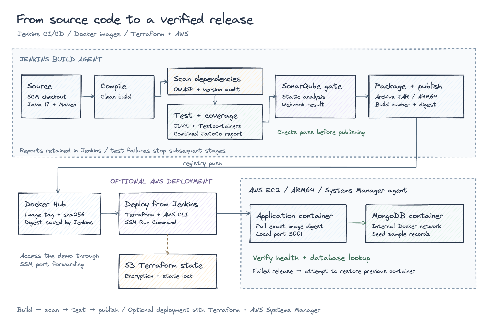
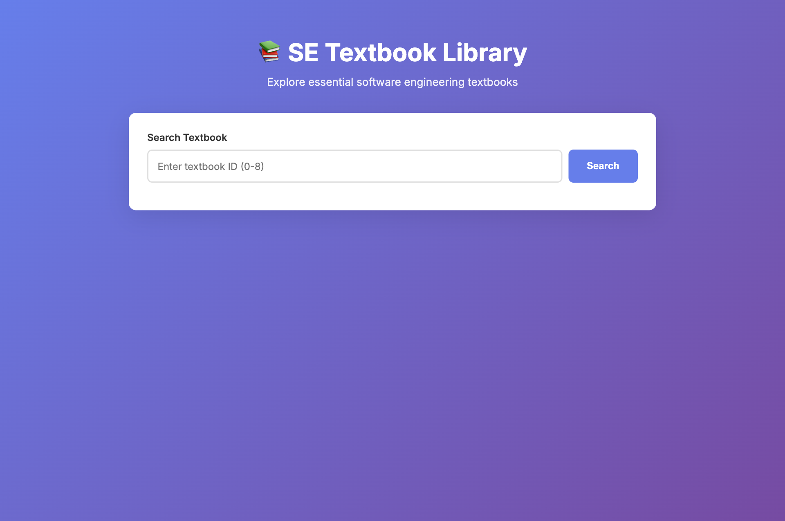

# CI/CD Pipeline with Jenkins, Docker & AWS

This project uses Jenkins to build a Java app, check its code and dependencies, run tests, and publish a Docker image. It also includes an optional AWS deployment stage.

A small Spring Boot app with MongoDB is used to show the pipeline in action.

## Architecture



[Editable Excalidraw file](docs/images/cicd-architecture.excalidraw) · [SVG diagram](docs/images/cicd-architecture.svg)

## How the pipeline works

| Step | What it does | Tools |
|---|---|---|
| Build | Downloads the code and compiles the app | Git, Maven, Java 17 |
| Scan dependencies | Checks libraries for known vulnerabilities and available updates | OWASP Dependency-Check, Maven |
| Test | Runs 6 unit tests and 10 tests with a real MongoDB container | JUnit, Testcontainers |
| Check code quality | Creates a coverage report and checks the SonarQube quality gate | JaCoCo, SonarQube |
| Package | Saves the app as a JAR and publishes an ARM64 Docker image | Maven, Docker Buildx, Docker Hub |
| Deploy to AWS — optional | Sets up EC2 and runs the published image | Terraform, AWS Systems Manager |

The build stops if tests fail or the SonarQube quality gate fails. Dependency-Check stops the build for findings with a CVSS score of 9 or higher.

## Build results

**Jenkins build #3 passed**, including all 16 tests and the SonarQube quality gate.

Jenkins saves the test results, dependency and coverage reports, application JAR, and `published-image.txt`. Docker Hub stores the image with the Jenkins build number as its tag. The text file records the image's unique digest, which identifies the exact image to deploy.

## Run locally

Start Docker Desktop, then run these commands from the project folder.

```bash
docker compose up --build -d
docker compose logs -f app
```

Once the app starts, open [localhost:3001](http://localhost:3001) and search for ID `0`. Compose starts MongoDB and loads nine sample records automatically.

To stop the app, run `docker compose down`.

## Sample app

The textbook app is the example packaged by this pipeline.



## Run the tests

Use Java 17, Maven 3.9 or later, and a running Docker engine.

```bash
mvn clean test
mvn -Pintegration-tests test
mvn jacoco:report
```

Open `target/site/jacoco/index.html` to view coverage.

## Jenkins and AWS setup

Follow the [setup guide](docs/operations.md) to configure Jenkins, SonarQube, and Docker Hub.

AWS deployment is controlled by the `DEPLOY_TO_AWS` checkbox, which is off by default. The optional stage uses Terraform to create EC2 resources and Systems Manager to start the app, check its health, and look up a sample record. It uses the exact image recorded by the publishing stage.

The setup guide includes AWS permissions, build parameters, and cleanup commands. Store tokens in Jenkins credentials. Use `.env.example` as a template for local settings.

## Background

This project grew from an SE441 course exercise. The Spring Boot app and sample data came from the course starter repositories. The project adds the Jenkins pipeline, Docker packaging, and Terraform deployment files.
